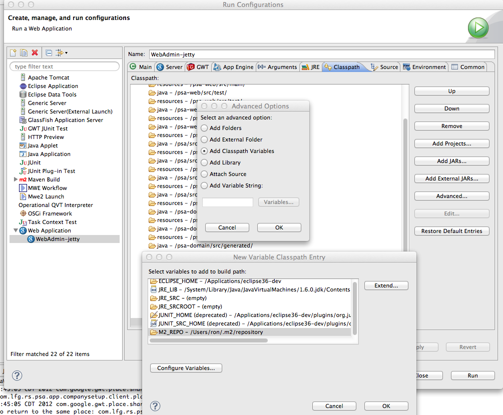
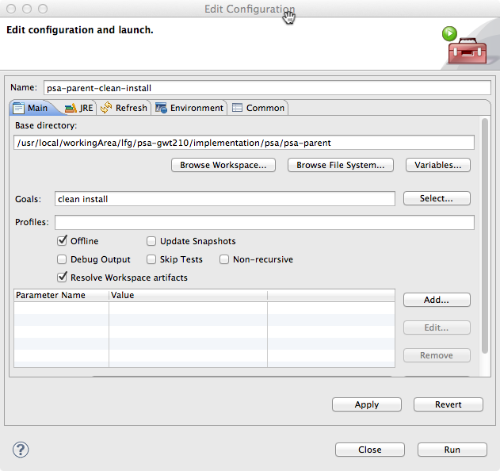
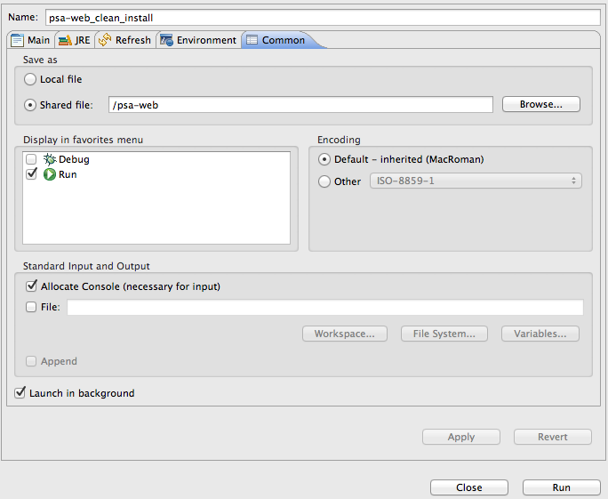

I'm using Eclipse, GWT, and Maven on a couple projects, and have several customized Eclipse run configurations I use. There's a bit of work and specific settings required to make these work well, and they have to be set up for each new workspace, so I'd like to set them up once and share them with the team.

Before being able to check these into source control, and make them available to the rest of the team, there's a couple things in these run configurations that have platform-specific references (e.g. the full path to files on my hard drive) that have to be fixed. Fortunately, if you know where to look it's not hard to change.

First, the GWT launch configuration which is generated by the [Google Eclipse Plugin](https://developers.google.com/eclipse/ "Google Eclipse Plugin") needs to be fixed. As described in this [stackoverflow question](http://stackoverflow.com/questions/3557369/how-to-use-variables-for-classpath-definition-in-eclipse-launch-configurations "stackoverflow question on GWT eclipse launcher"), the classpath used by the launcher contains a hard-coded full path to the GWT development jar on your computer. The solution is to change the path to be relative to a classpath variable which is defined at the workspace level. In my case, I need to use the M2\_REPO classpath variable which points to my local Maven repository.

To change this, open the Eclipse Run Configuration for the GWT launcher in question, select the Classpath tab, click the "Advanced" button on the right to add a new classpath entry, choose "Classpath Variable" in the dialog that comes up, then choose the classpath variable you want to use. Assuming the jar file you need to select is in a subdirectory below the classpath variable, click on "Extend" to navigate to the jar file relative to the classpath variable. 

Once your new classpath entry is in place, you can remove the old one with the hard-coded path.

For the Maven run configurations, the only thing that was platform-specific was the base directory setting on the first tab, which by default is the full directory path to the project.

To make this portable, you can make this location relative to the named project that's loaded in the current workspace. Click "Browse Workspace..." and select the project that the Maven build should run from. You'll end up with a location like ${workspace\_loc:/my-project}.

For both of these run configurations, the last thing that needs to be done is to save them as a file within the project. Select the last tab of the run configuration, "Common", select "Shared File" under "Save as", and choose a directory for the run configuration to be saved to.

. You can now check these files into source control and load them into another workspace.
