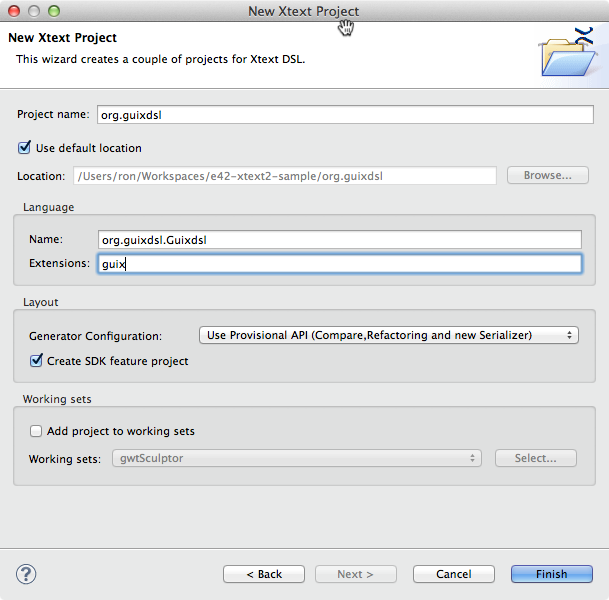
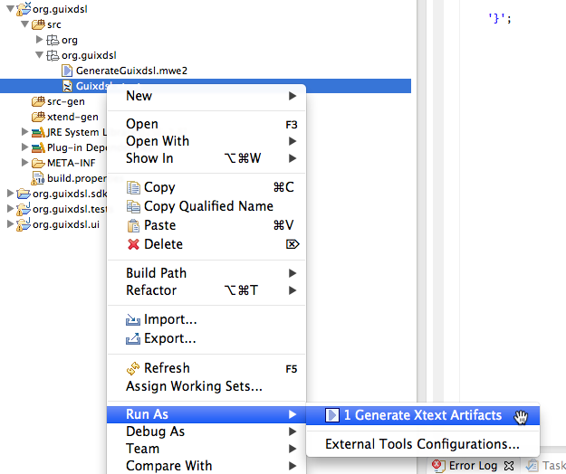
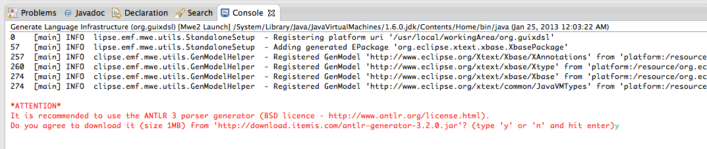
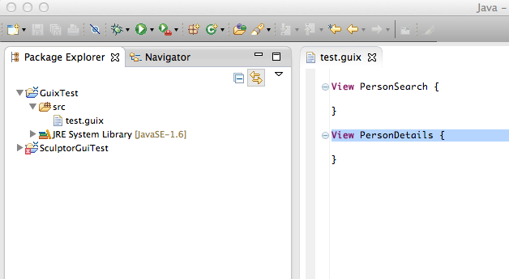
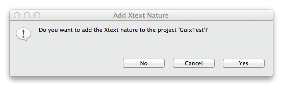
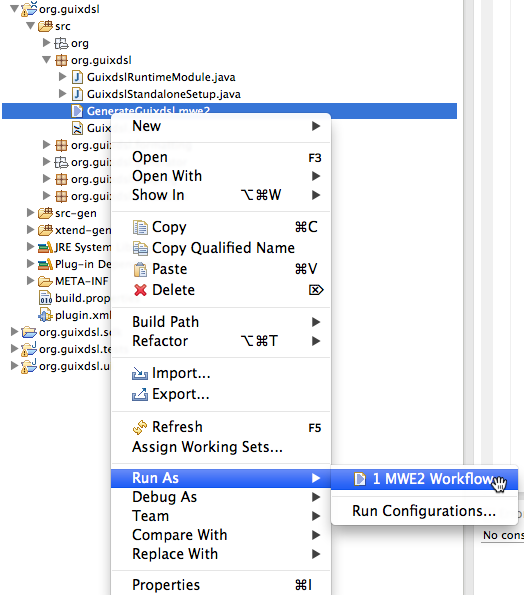

This is the first in a series of posts where I'll explore XText2 by porting an existing XText1-based DSL to XText2. The DSL to be ported is a GUI-description language based on the [Sculptor DSL](http://fornax.itemis.de/confluence/display/fornax/Sculptor+%28CSC%29 "Sculptor DSL") that generates [Google Web Toolkit UIs](https://developers.google.com/web-toolkit/) using the [Activities and Places framework](https://developers.google.com/web-toolkit/doc/latest/DevGuideMvpActivitiesAndPlaces).

The first step is to set up a new XText2 project and prepare it to start adding elements from the existing DSL. We can create the XText 2 project via the steps in the [First Five Minutes Tutorial](http://www.eclipse.org/Xtext/documentation.html#FirstFiveMinutes).



Once the project is set up, let's replace the starter DSL in GuixDsl.xtext with a couple elements of the real DSL; a minimal View and Gui Module definition:

```text
grammar org.guixdsl.Guixdsl with org.eclipse.xtext.common.Terminals

generate guixdsl "http://www.guixdsl.org/Guixdsl"

DslModel:
    elements+=DslAbstractGuiElement*;

DslAbstractGuiElement :
    DslGuiModule | DslView;

DslGuiModule:
    (documentation=STRING)?
    'Module' name=ID '{'
        ("hint" "=" hint=STRING)?
    '}';

DslView:
    (documentation=STRING)?
    'View' name=ID '{'

    '}';
```

The language artifacts, including the Eclipse editor, can be generated by selecting the Guixdsl.xtext file and selecting  context->Run As->Generate XText Artifacts.



The first time you generate language artifacts, the MWE2 workflow prompts you as to whether you want to download the ANTLR 3 parser generator (recommended), which it has to do due to a license conflict of some sort. Say yes and proceed.



Once the language artifacts have been generated, we can take the DSL out for a spin by selecting the org.guixdsl project, and selecting context->Run As->Eclipse Application.  This will launch a new Eclipse instance with our DSL plugins installed.  Once in the new Eclipse instance, we can create a new test Java project, and create a test DSL file in the project source folder.



If you get a dialog that asks whether you want to add the Xtext nature to the test project, be sure to say Yes. I thought this was only needed to edit the language grammar or code generators. I found out the hard way that your custom code generator won't get executed unless you have the XText nature enabled, but oddly enough, the JVM model inferrer will. But more about the code generator and inferrer below.



We'll come back to this test project throughout the development of the new DSL to test out different features. For now, we just want to make sure our minimal DSL and generated language artifacts worked ok.

One of the new features of XText2 is the ability to map DSL concepts directly to Java types, which XText then directly generates code for. This mapping is defined by implementing an inferrer class that extends AbstractModelInferrer.

Of course, generating code via templates is still supported, and done by defining a class that implements IGenerator. When you create a new XText project, by default it's set up to use the generator strategy rather than the inferrer. Our goal is to use both. The existing XText1-based project uses XPand templates, which can be converted to XTend2 templates. At the same time, we'd like to start using the Java types inferrence approach for some classes.

It wasn't obvious how to switch to using the inferrer strategy. Close inspection of the "[Five simple steps to your JVM language](http://www.eclipse.org/Xtext/documentation.html#_6)" tutorial showed what needed to be changed to start using the inferrer. In your xtext grammar, replace:

```text
grammar org.Guixdsl with org.eclipse.xtext.common.Terminals
```

with:

```text
grammar org.Guixdsl with org.eclipse.xtext.xbase.Xbase
```

Run the GenerateGuixdsl.mwe2 MWE2 workflow to generate everything, including the code generation infrastructure, based on the DSL.



This yields a JVM model inferrer class ready to go:

```java
package org.guixdsl.jvmmodel

import com.google.inject.Inject
import org.eclipse.xtext.xbase.jvmmodel.AbstractModelInferrer
import org.eclipse.xtext.xbase.jvmmodel.IJvmDeclaredTypeAcceptor
import org.eclipse.xtext.xbase.jvmmodel.JvmTypesBuilder
import org.guixdsl.guixdsl.DslModel

/**
 * <p>Infers a JVM model from the source model.</p>
 *
 * <p>The JVM model should contain all elements that would appear in the Java code
 * which is generated from the source model. Other models link against the JVM model rather than the source model.</p>
 */
class GuixdslJvmModelInferrer extends AbstractModelInferrer {

    /**
     * convenience API to build and initialize JVM types and their members.
     */
    @Inject extension JvmTypesBuilder

    /**
     * The dispatch method {@code infer} is called for each instance of the
     * given element's type that is contained in a resource.
     *
     * @param element
     *            the model to create one or more
     *            {@link org.eclipse.xtext.common.types.JvmDeclaredType declared
     *            types} from.
     * @param acceptor
     *            each created
```

This works great, but switching to use the XBase base grammar caused the generator strategy to get disabled. For this DSL, we need to be able to generate some classes via JVM inference, and some via template-based code generation. Thanks to the [this post on RCP Vision](http://www.rcp-vision.com/?p=1640) for info on this & how to re-enable the generator.

What happened is XText switched the generator from our generator, GuixdslGenerator, to org.eclipse.xtext.xbase.compiler.JvmModelGenerator, which generates code based on inferred types.

You can see the binding in the AbstractGuixdslRuntimeModule generated module in the org.guixdsl project where both the generator and the inferrer are bound.

```java
// contributed by org.eclipse.xtext.generator.xbase.XbaseGeneratorFragment
public Class<? extends org.eclipse.xtext.generator.IGenerator> bindIGenerator() {
    return org.eclipse.xtext.xbase.compiler.JvmModelGenerator.class;
}

// contributed by org.eclipse.xtext.generator.xbase.XbaseGeneratorFragment
public Class<? extends org.eclipse.xtext.xbase.jvmmodel.IJvmModelInferrer> bindIJvmModelInferrer() {
    return org.guixdsl.jvmmodel.GuixdslJvmModelInferrer.class;
}
```

To re-enable the generator class, update the binding in GuixdslRuntimeModule, which extends AbstractGuixdslRuntimeModule and is generated only once (can be modified whereas AbstractGuixdslRuntimeModule cannot).

```java
/**
 * Avoid using the default org.eclipse.xtext.xbase.compiler.JvmModelGenerator
 * when using xbase.
 * @see org.guixdsl.AbstractGuixdslRuntimeModule#bindIGenerator()
 */
@Override
public Class<? extends IGenerator> bindIGenerator() {
    return GuixdslGenerator.class;
}
```

Now the generator is back and getting invoked, but generation isn't happening for any inferred types. This is because although the inferrer is getting called, the JvmModelGenerator is the class that actually generates the code, and we just switched it off above. We want to have both our custom generator, and generation based on inferred types. To enable both, modify our generator to extend JvmModelGenerator, and delegate to it.

```java
class GuixdslGenerator extends JvmModelGenerator {

    override void doGenerate(Resource resource, IFileSystemAccess fsa) {
        super.doGenerate(resource, fsa)
                ...
    }

}
```

Now both will work:

- Generation of any inferred types we define in GuixdslJvmModelInferrer
- Custom, template-based generators defined in GuixdslGenerator

In a future post, we'll add support for package definitions to the language, and start generating GWT code.
