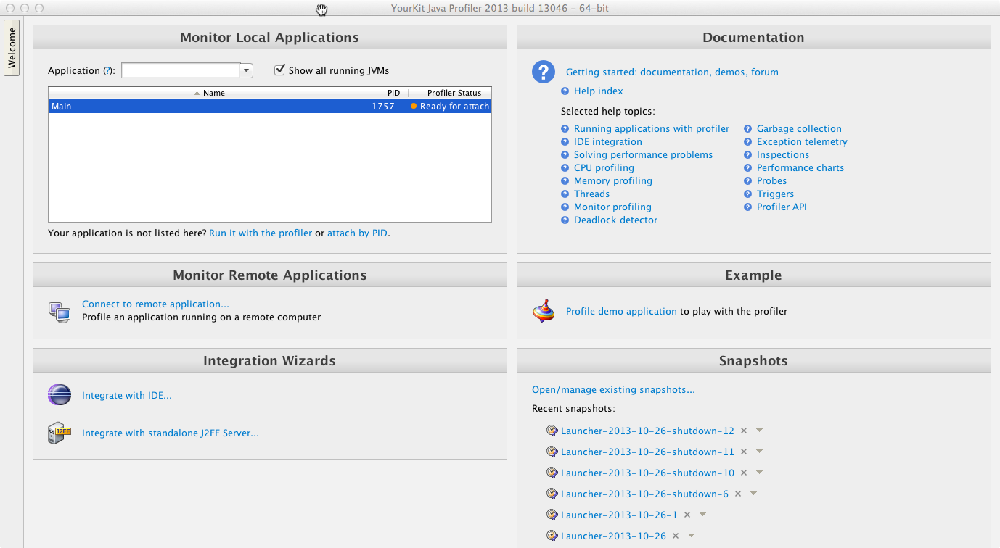
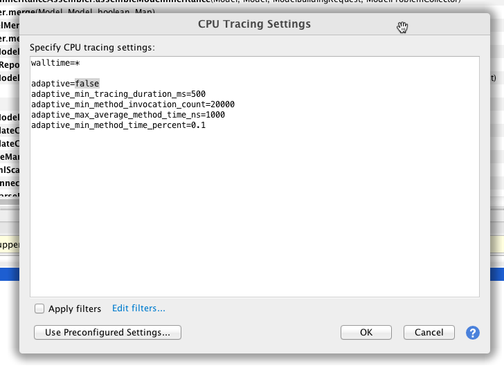
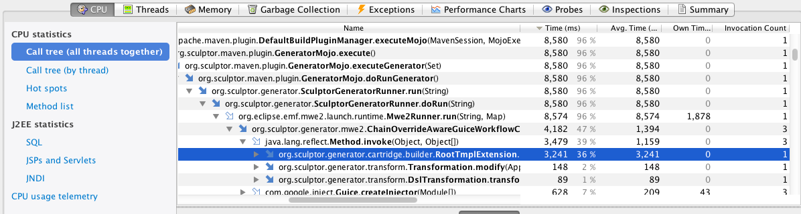
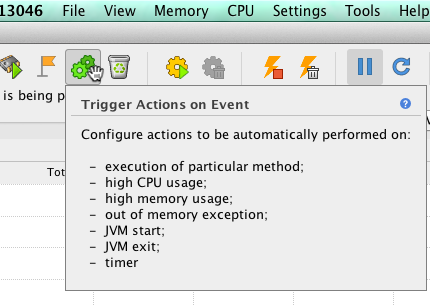
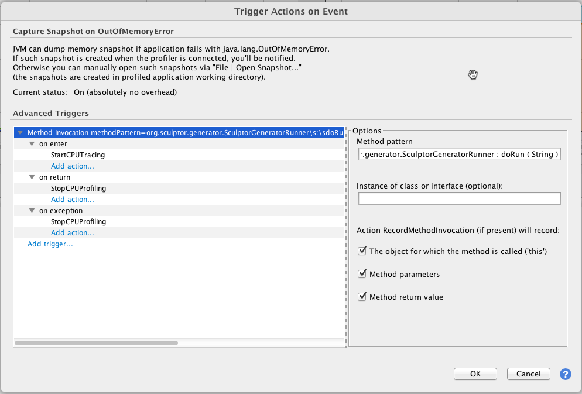

The latest version of the [Sculptor Generator](http://sculptorgenerator.org/) is based on [XTend 2](http://www.eclipse.org/xtend/), which is compiled to Java/Bytescode rather than interpreted as XTend1 and XPand was. This should bring large performance improvements to the code generation cycle, and it certainly _feels_ faster for my projects. Of course, since code generation is part of the development cycle, we'd always like the performance to be better. In order to improve the performance, we first need to know what the bottlenecks are, which is where a profiler comes in; specifically I'll describe using [YourKit](http://www.yourkit.com/) to profile code generation for one of the Sculptor sample projects.

The first step is to start the YourKit profiler. YourKit will start up with the welcome view, and will show any running Java processes, ready to attach to one of them.



Now we need to execute the Sculptor generator, first attaching it to the YourKit process. Sculptor code generation is typically executed as part of a Maven build, via the Sculptor Maven plugin. Since Maven isn't a long-running process, and we want to make sure to profile all of the code generation cycle, the best way to attach Sculptor to Maven is to do it at Maven startup via JVM command line arguments. Specifically [\-agentpath](http://www.yourkit.com/docs/yjp2013/help/agent.jsp) to attach the process to YourKit and enable profiling, and YourKit [startup options](http://www.yourkit.com/docs/yjp2013/help/startup_options.jsp) that can be used to enable different types of profiling, taking snapshots, etc.

To pass these arguments to Maven, we can use the MAVEN\_OPTS environment variable. I already had some JVM arguments to set the maximum memory. So on my Mac, I ended up with:

```
#!bash
export MAVEN_OPTS='-agentpath:/Applications/YourKit_Java_Profiler_2013_build_13046.app/bin/mac/libyjpagent.jnilib=tracing,onexit=snapshot -Xmx1424m -XX:MaxPermSize=1024m'
```

The above will enable the [tracing profiling method](http://www.yourkit.com/docs/80/help/cpu_intro.jsp) (vs sampling), and instruct YourKit to record a snapshot that may later be inspected on process exit.

You can control how YourKit performs tracing via Settings -> CPU Tracing... The only [tracing setting](http://www.yourkit.com/docs/yjp2013/help/tracing_settings.jsp) I changed was to disable adaptive tracing, which omits some small frequently called methods from profiling. This lessens the profiling overhead, but I'm not really concerned about that and want to make sure I'm getting complete results.



Now that the options are set up, run Maven in the Sculptor project to be profiled. In my case, the [library-example project](https://github.com/sculptor/sculptor/tree/master/sculptor-examples/library-example):

```
#!bash
mvn sculptor:generate -Dsculptor.generator.force=true
```

Once it's done executing, we can open the previously recorded snapshot via File->Open Snapshot.., and look at the different reports and views. This is what the call tree view looks like:



These results are fine, but the trace results are cluttered with many methods we're not interested in, since the entire Maven execution has been traced. The best option I found to only trace those methods we're interested in was to initially disable tracing, then use a [YourKit Trigger](http://www.yourkit.com/docs/yjp2013/help/triggers.jsp) to enable tracing on entry and exit of the main Sculptor generation method, org.sculptor.generator.SculptorGeneratorRunner.doRun.

In YourKit, you can add a trigger via the "Trigger action on event" button.



The problem is this button seems to only be enabled if YourKit is actively profiling an application, and since the Maven execution isn't a long-running process, you can't configure it in time. The solution I used was to start Maven suspended in debug mode, configure the trigger, then kill Maven. Again, this can be done by adding some JVM arguments to MAVEN\_OPTS, and running Maven again:

```
#!bash
export MAVEN_OPTS='-agentpath:/Applications/YourKit_Java_Profiler_2013_build_13046.app/bin/mac/libyjpagent.jnilib=tracing,onexit=snapshot -Xmx1424m -XX:MaxPermSize=1024m -Xrunjdwp:transport=dt_socket,address=8000,server=y,suspend=y'
```

Once YourKit is attached to the running Maven process, we can add the trigger:



To be able to use this trigger each time Sculptor is executed via Maven, we have to export the trigger configuration into a file, then when running Maven, specify the trigger file via another YourKit argument. We can export the trigger via Popup menu->Export Triggers...

Following is the exported trigger configuration. The above steps are just a means to end up with this configuration, so you can skip them and simply copy the following into a triggers.txt file.

```
MethodListener methodPattern=org.sculptor.generator.SculptorGeneratorRunner\s:\sdoRun\s(\sString\s) instanceOf= fillThis=true fillParams=true fillReturnValue=true maxTriggerCount=-1
  onenter: StartCPUTracing
  onreturn: StopCPUProfiling
  onexception: StopCPUProfiling
```

To specify the trigger file that should be used, use the 'triggers' command line argument. Since tracing will now be enabled via the trigger, I also removed the 'tracing' argument so tracing wouldn't be enabled on startup:

```
#!bash
export MAVEN_OPTS='-agentpath:/Applications/YourKit_Java_Profiler_2013_build_13046.app/bin/mac/libyjpagent.jnilib=triggers=triggers.txt,onexit=snapshot -Xmx1424m -XX:MaxPermSize=1024m'
```
