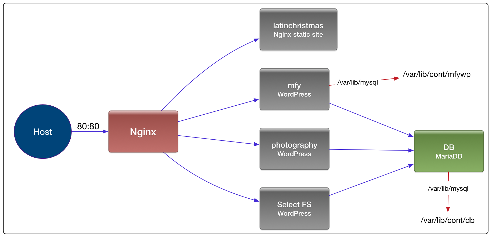

There's several sites I host for family and friends in addition to this site. It's a mix of WordPress, Drupal, and static sites, all running on a Linux virtual host hosted by [Rackspace](http://www.rackspace.com/). The Linux host is pretty old at this point, and really should be upgraded. Additionally, I wanted to give [DigitalOcean](https://www.digitalocean.com/) a try as I can get a virtual server there for less.

Although I kept the installations for each site pretty well organized in different directories, migrating them over the traditional way would still be time consuming and error prone, involving copying over all the directories and databases that are needed, migrating users, making sure permissions are right, and making sure to get any service scripts and configurations that need to come along. This is all a very manual process. If (when) I get something wrong, I'd have to troubleshoot it on the target server, and the whole process isn't very repeatable nor version controlled. I wasn't looking forward to it.

While working on our Pilot product at [Encanto Squared](http://encantosquared.com/), a new tool came on our radar, [Docker](https://www.docker.com/), which we adopted and greatly simplified and streamlined our deployment and server provisioning process at Encanto.

Naturally, I decided to use docker to migrate my sites to another server, and to generally improve how these are being managed.

The overall configuration looks like this:



The above diagram is inspired by [this dockerboard](http://dockerboard.github.io/marsoon/) tool. The tool works but the diagram required some style tweaking so I did it in OmniGraffle.

Each of the rounded rectangles above is a separate docker container, and all of the containers are orchestrated by [docker compose](https://docs.docker.com/compose/). The blue lines between the containers are [docker compose links](https://docs.docker.com/compose/compose-file/#links), which connect the two containers at a network level, and create an entry in the source's host file pointing to the target container. Each docker container runs with its own network, layered filesystem, and process space. So for one container to be able to communicate with another it has to be specifically enabled, via links in the case of docker compose.

Following is a breakdown of each container and its configuration:

## nginx - front-end reverse proxy

- I'm using this as a reverse proxy into the other docker containers.
- This is the only container with an exposed port, 80
- It has a link to each of the individual site containers to be able to proxy HTTP requests to them.
- In the future, I may have this serve up the static sites rather than proxying to another nginx process. It'll still be needed to proxy the WordPress and Drupal sites
- This image is based on the official [nginx](https://hub.docker.com/_/nginx/) image, with the addition of the Nginx configuration files into the Docker image. Dockerfile:

```dockerfile
FROM nginx
COPY conf.d /etc/nginx/conf.d
```

- Each of the sites gets a separate Nginx configuration file under conf.d. They proxy to the specific site by name (mfywordpress in the example below). Here's what one of them looks like:

```nginx
server {
  listen 80;
  server_name www.mfyah.org mfyah.org;

  location / {
    proxy_pass http://mfywordpress:80;
    proxy_set_header Host $host;
    proxy_set_header X-Real-IP $remote_addr;
    proxy_set_header X-Forwarded-For $proxy_add_x_forwarded_for;
  }
}
```

## latinchristmas - This is a static site hosted by nginx

- This is a static site served up by its own nginx process.
- This is an image that is based on the official nginx image. The only thing it does in addition is add the static content to /usr/share/nginx/html
- Dockerfile:

```dockerfile
FROM nginx

COPY WWW /usr/share/nginx/html
```

## mfy - Wordpress-based site

- This image is based on the official [WordPress image](https://hub.docker.com/_/wordpress/), with some additional packages installed.
- The official WordPress image uses Apache.
- This container maps the directory /var/www/html to /var/lib/cont/mfywp on the host to store the WordPress site files. Having the site files on the host makes it easier to backup and ensures any changes to the site survive a restart.
- Dockerfile:

```dockerfile
FROM wordpress

RUN apt-get update && apt-get install -y libcurl4-openssl-dev

RUN docker-php-ext-install curl
```

I won't go into the other WordPress-based containers. They're essentially the same.

## DB - MariaDB

- This is the database for all of the WordPress sites.
- This container maps the directory /var/lib/mysql to /var/lib/cont/db on the host to store the database files so they survive restarts & can be backed up easily.
- It is running the [official MariaDB Docker image](https://hub.docker.com/_/mariadb/).

## Docker compose and usage

As mentioned above, all of this is managed by Docker Compose. Following is a portion of the Docker Compose configuration file.

```yaml
latinchristmas:
  image: somedockerrepo/someuser/latinchristmaswebsite:latest
  restart: always

mfywordpress:
  image: somedockerrepo/someuser/mfy
  restart: always
  links:
    - db:mysql
  environment:
    WORDPRESS_DB_NAME: mfy
  volumes:
    - /var/lib/cont/mfywp:/var/www/html

db:
  image: mariadb
  restart: always
  environment:
    MYSQL_ROOT_PASSWORD: PutSomethingHere
  volumes:
    - /var/lib/cont/db:/var/lib/mysql

nginx:
  build: nginx
  restart: always
  ports:
    - "80:80"
  links:
    - latinchristmas
    - mfywordpress
```

The WordPress-based site images are stored on a Docker repository. The proxy nginx image is built locally by Docker Compose.

The steps I took to get this all working on the server were roughly:

- Install Docker if it's not already there: `sudo apt-get install lxc-docker`
- Create the directories for the individual sites (e.g. /var/lib/cont/mfywp) and copy the site files over to them
- Create the directory for the database under /var/lib/cont/db, empty
- Copy the Docker Compose file and the nested nginx Dockerfile and configuration files over to the server. This is in a git repository, so I packaged it up as a tar file to send: `git archive --format=tar --prefix=rpstechServer/ HEAD > send.tar`
- If you're hosting your images in a private Docker repository, create a .dockercfg file on the server containing the credentials to your private Docker repository. Docker Compose will use this on the server when pulling the images from the Docker repository. If your images are all in a public repository, this isn't needed. You can remove the .dockercfg after the next step to avoid having the credentials on the server.
- Run `docker-compose up -d`

Everything should be running at this point.

I haven't converted over the Drupal sites yet, but the approach will be the same as the WordPress sites.

The benefits to this setup are:

- Each site is largely self contained and easy to migrate to a different server
- The sites are independent of each other. I can install new and upgrade packages of one site without affecting other sites.
- I'm able to make changes and run the sites locally and test them out before pushing out any changes.

Future improvements:

- Avoid having the MariaDB password in the Docker Compose or any other file
- Combine some of the lines in the Dockerfiles, reducing the number of Docker layers that are created
- Consider running the WordPress sites using a lighter weight process rather than requiring Apache. Maybe this isn't a problem at all.
