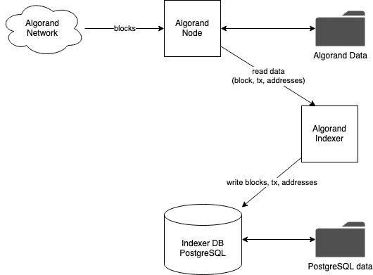
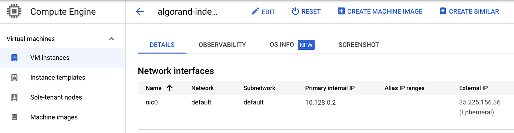
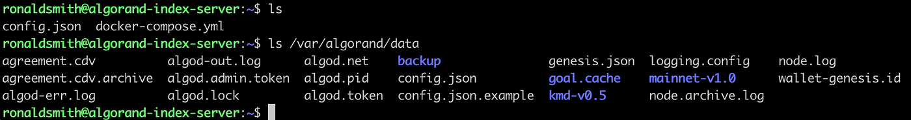
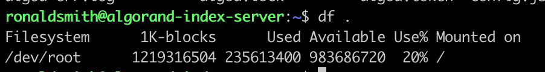
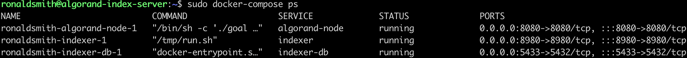
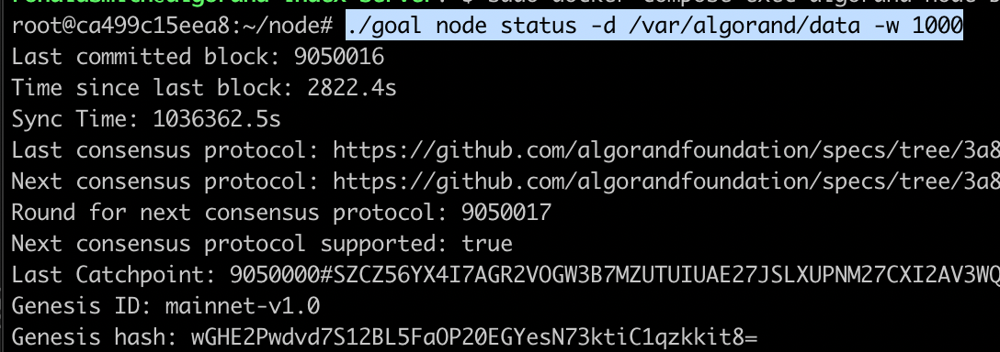
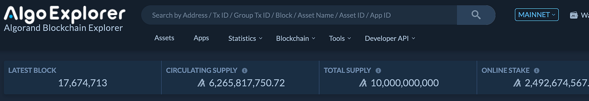
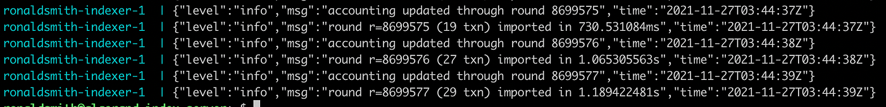

I’ve been exploring Algorand as a blockchain platform to build on. Algorand supports smart contracts via its own virtual machine, has a good transaction rate, low fees, is decentralized, and uses a proof of stake consensus algorithm.

This post starts off exploring the Algorand network and blockchain data. Specifically, how to run an Algorand node, and an [Algorand Indexer](https://github.com/algorand/indexer) to explore the data in the blockchain. The Algorand Node synchronizes with the Algorand network and receives all block, transaction, and address data. The Algorand Indexer connects to and reads data from the Algorand Node, and stores data in an easy to search structure in PostgreSQL.



To get this all running, in this article we’re going to walk through:

- Creating a virtual machine in Google Cloud Platform via Vagrant
- Setting up the VM with everything we need including Docker
- Running the [Algorand Indexer](https://github.com/algorand/indexer), PostgreSQL, and Algorand Node via Docker compose
- Checking progress of syncing and indexing

We’ll explore querying the data in the indexer in a future post.

The code related to this post can be found at:

- Algorand Indexer Docker image  
    [https://hub.docker.com/repository/docker/rcodesmith/algorand-indexer](https://hub.docker.com/repository/docker/rcodesmith/algorand-indexer)  
    [https://github.com/rcodesmith/indexer/tree/rcodesmith/v1](https://github.com/rcodesmith/indexer/tree/rcodesmith/v1)
- Algorand Indexer Server  
    [https://github.com/rcodesmith/algorand-indexer-server](https://github.com/rcodesmith/algorand-indexer-server)

## Google or other cloud provider

The examples and code here are based on Google Cloud. You can sign up for an account with a free tier if you don’t have one already. The code and examples here can be adapted to another code provider, or to run everything locally. The main thing you’d need to do is change the Google-specific parts of the Vagrantfile.  
  

To host on Google, follow the steps in [https://github.com/mitchellh/vagrant-google#google-cloud-platform-setup](https://github.com/mitchellh/vagrant-google#google-cloud-platform-setup) to:

- Set up a Google account if you don’t have one
- Create a new project if you don’t have one and enable Compute Engine API
- Create a service account, export its JSON API key.  
    Note the service account email, and save the JSON API key file. You’ll need both later.
- Add an SSH key you want to use to the Compute Engine.

I don’t see the steps in the above link calling out a role to assign the new service account. I gave the service account “Compute Admin” role in IAM to make sure it could create the server.

## Automating server creation and setup

We use Vagrant to automate the creation and setup of the Google VM. Vagrant can be used to automate creation of multiple types of VMs in the cloud and locally. If you don’t have it installed already, you can do so [here](https://www.vagrantup.com/docs/installation).  
  

To create a Google Cloud VM, you’ll also need to install the [Vagrant Google plugin](https://github.com/mitchellh/vagrant-google).  
  

```shell
vagrant plugin install vagrant-google
```

Following is a sample [Vagrantfile](https://github.com/rcodesmith/algorand-indexer-server/blob/master/Vagrantfile) to create the VM.  
  

```ruby
Vagrant.configure("2") do |config|
  config.vm.box = "google/gce"

# Provider to set up VM in Google Cloud
  config.vm.provider :google do |google, override|
    google.google_project_id = "<Your google cloud project ID here>"
    google.google_json_key_location = "<Path to JSON key here>"

    # 2vCPU, 4GB
    google.machine_type='e2-medium'

    # Use Ubuntu 20.04
    google.image_family = 'ubuntu-2004-lts'

    google.name = 'algorand-index-server'
  
    # Allocate 400 GB for disk.  You may need more if running
    # mainnet node
    google.disk_size = '400'
      
    # Tags to apply to server
    google.tags = ['algorand-indexer']

    override.ssh.username = "<username you want to create on server>"
    override.ssh.private_key_path = "<local path to your SSH private key you want to use>"
  end

  # Copy docker-compose.yml and Algorand Node config files to VM
  config.vm.provision "file", source: "./docker-compose.yml", destination: "docker-compose.yml"
  config.vm.provision "file", source: "./node-config.json", destination: "config.json"

  # Execute setup script on the VM
  config.vm.provision "shell", path: "setup.sh"
  end
```

The Vagrantfile will create the VM in Google Cloud, set up an SSH user on it, copy docker-compose.yml and node-config.json to the VM, and finally run the setup.sh script to do the rest of the setup.  
  

Note: you’ll need to substitute the <…> in the file with your own values.  
  

The [setup.sh](https://github.com/rcodesmith/algorand-indexer-server/blob/master/setup.sh) file, copied to the server and executed by Vagrant, provisions the server, installing all the needed packages, setting up directories and populating them, and finally runs the services in the docker-compose.yml:  
  

```shell
#!/bin/sh

#
# Setup script for VM
#

# Exit on any error
set -e

# Install docker: https://docs.docker.com/engine/install/ubuntu/
sudo apt-get update
sudo apt-get install \
    ca-certificates \
    curl \
    gnupg \
    lsb-release

curl -fsSL https://download.docker.com/linux/ubuntu/gpg | sudo gpg --dearmor -o /usr/share/keyrings/docker-archive-keyring.gpg

echo \
  "deb [arch=$(dpkg --print-architecture) signed-by=/usr/share/keyrings/docker-archive-keyring.gpg] https://download.docker.com/linux/ubuntu \
  $(lsb_release -cs) stable" | sudo tee /etc/apt/sources.list.d/docker.list > /dev/null

sudo apt-get update
sudo apt-get install -y docker-ce docker-ce-cli containerd.io

# Install Docker compose
wget https://github.com/docker/compose/releases/download/v2.1.0/docker-compose-linux-x86_64
sudo mv ./docker-compose-linux-x86_64 /usr/local/bin/docker-compose
sudo chmod a+x /usr/local/bin/docker-compose

# Create data directory for algorand, which will be shared among node & indexer
sudo mkdir -p /var/algorand/data

# Data directory for postgresql
sudo mkdir  -p /var/lib/postgresql/data/

# Copy node-config.json to data directory
sudo cp config.json /var/algorand/config.json

# Bootstrap Algorand node data directory on VM from algorand-node docker image
sudo docker-compose run algorand-node sh -c "cp -R /root/node/data/* /var/algorand/data/"
sudo docker-compose run algorand-node sh -c "cp /var/algorand/config.json /var/algorand/data/"

# Start everything up
sudo docker-compose up -d
```

## Docker Compose

[Docker Compose](https://docs.docker.com/compose/) orchestrates the three docker containers which must be run:

- Algorand Node
- Algorand Indexer
- PostgreSQL database used by indexer

Following is the docker-compose.yml which sets up all of the above containers. Comments describe each element.

```yaml
version: "2.4"
services:
  # Algorand node.  Can't use catchup mode, so takes a long time
  # to get to current block.
  algorand-node:
    # Use Algorand tesnet.  To use mainnet, change to algorand/stable.
    image: algorand/testnet
    command: /bin/sh -c "./goal node start -l 0.0.0.0:8080 -d /var/algorand/data && sleep infinity"
    ports:
      - 8080:8080
    volumes:
      # Mount data directory on host so block data survives container.
      - /var/algorand/data:/var/algorand/data:rw
      # Mount config so it can be changed outside image
      - /var/algorand/config.json:/var/algorand/config.json:ro

  # Postgres database where indexer stores data
  indexer-db:
    image: "postgres"
    ports:
      - 5433:5432
    expose:
      - 5432
    environment:
      POSTGRES_USER: algorand
      POSTGRES_PASSWORD: indexer34u
      POSTGRES_DB: pgdb
    volumes:
      - /var/lib/postgresql/data/:/var/lib/postgresql/data/:rw

  # Algorand indexer which reads from algorand-node,
  # and writes to indexer-db
  indexer:
    image: "rcodesmith/algorand-indexer:2.6.4"
    ports:
      - 8980:8980
    restart: unless-stopped
    environment:
      DATABASE_NAME: pgdb
      DATABASE_USER: algorand
      DATABASE_PASSWORD: indexer34u
      ALGORAND_HOST: algorand-node
    depends_on: 
      - indexer-db
      - algorand-node
    volumes:
      # Mount Algorand node data, to get token
      - /var/algorand/data:/var/algorand/data:rw
```

## Indexer docker image

The Indexer is the one component where we’re not using an existing Docker image. I forked the indexer repo and added a [Dockerfile](https://github.com/rcodesmith/indexer/blob/rcodesmith/v1/Dockerfile):

```dockerfile
FROM golang:alpine

# Dependencies
RUN apk add --update make bash libtool git python3 autoconf automake g++ boost-dev busybox-extras curl

# Add code to gopath and build
RUN mkdir -p src/github.com/algorand/indexer
WORKDIR src/github.com/algorand/indexer
COPY . .
RUN make

# Launch indexer with a script
COPY run.sh /tmp/run.sh
CMD ["/tmp/run.sh"]
```

The Indexer docker image can be found on docker hub [here](https://hub.docker.com/repository/docker/rcodesmith/algorand-indexer), and the github repo is [here](https://github.com/rcodesmith/indexer/tree/rcodesmith/v1).  
  

## Create VM via Vagrant

Now that we’ve reviewed everything, it’s time to create the server and start everything up.  
  

To do everything, run the following in the [algorand-indexer-server](https://github.com/rcodesmith/algorand-indexer-server) top directory:  
  

```shell
vagrant up --provider=google
```

If it completes successfully, the VM has been created, and all of the containers have been started up.  
  

To work with the VM, you’ll need the public IP address that’s been allocated by Google. You can find it in Google Cloud Console, Compute Engine page.  
  



You should now be able to SSH into the server, using the username and SSH key you substituted earlier in the Vagrantfile. e.g.  
  

```shell
ssh ronaldsmith@35.225.156.36
```

Once you’re on the server, a couple things to point out:  
  

The docker-compose.yml is in the user’s home directory. /var/algorand/data contains the Algorand Node data. This is also where the Node config.json is stored.  
  



You can check on the volume free space via ‘df’.  
  



Note that we’re running a full Algorand node, so it has a copy of all block data, and is continuously increasing in size.  
  

You can confirm everything is running in docker-compose:  
  



## Inspecting containers in docker-compose

As these containers run, the Node will continue to receive blocks from the Algorand network, and the Indexer will continue to index data into PostgreSQL. It can take days for everything to get caught up.  
  

To check the status of the node, first, start an interactive bash shell in the algorand-node container:  
  

```shell
sudo docker-compose exec algorand-node bash
```

Then use ‘goal node status’ to get the status of the Node process  
  



In the example above, the Node process last processed block 9,050,016. Note in this example I was running a Node on mainnet.  
  

You can check this against the latest block generated by the network as reported in [Algorand Explorer](https://algoexplorer.io/):  
  



You can change the network (mainnet or testnet) in the top right. In this case, the latest block generated is 17,674,713, so my node is about halfway caught up with the network.  
  

To check the progress of the Indexer, look at the output of the Indexer container via the docker-exec tail command:  
  

```shell
sudo docker-compose logs --tail=100 indexer
```



The “rounds” correspond to the block numbers.  
  

## Stopping and Deleting everything

Since all of the persistent state, the algorand node data and PostgreSQL storage, is stored in volumes outside the docker containers, you can safely stop everything and start everything back up later on the VM:  
  

```shell
# To stop and remove all containers:
sudo docker-compose stop
sudo docker-compose rm

# To start everything back up:
sudo docker-compose up -d
```

When all done, you can delete everything, including the VM, via Vagrant:  
  

```shell
vagrant destroy
```

## Summary

We now have all Algorand blockchain data being synchronized to a PostgreSQL database. We’ll follow up in a future post with how to query that data via Indexer APIs, or directly in PostgreSQL.
