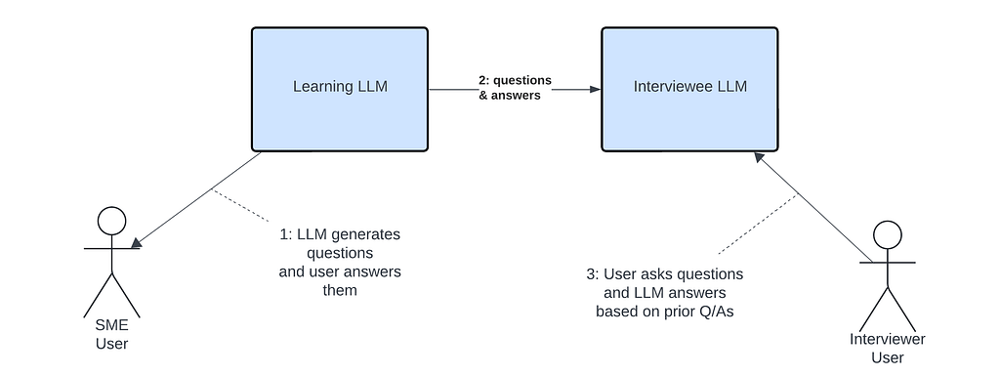

Traditionally, we interact with Large Language Models (LLMs) by posing questions and receiving answers based on their pre-existing training data.

I wanted to explore a different approach: a chatbot that learns through inquiry, asking questions of a human user to build its knowledge base, and then leveraging that information to generate responses or answer questions.

This approach has numerous potential applications, ranging from preserving family histories and conducting oral history projects to creating AI agents that could represent job candidates in preliminary screening interviews. In this post, we’ll delve into a possible technique for building such an inquiry-based learning chatbot using a prompting technique.

The learning chatbot would operate in two distinct modes:

1. Learning Mode: The chatbot gathers information by asking users a series of questions and storing their responses.
2. Interview Mode: Drawing upon the information gathered during the Learning Mode, the chatbot provides informed responses to user queries.

This dual-mode approach allows the chatbot to build a knowledge base through inquiry-based interactions, then apply that knowledge in subsequent conversations.

The approach we’ll take is to have two separate LLM sessions:

- A learning LLM session, with a system prompt tailored to the LLM generating questions which a Subject Matter Expert User will answer.
- Transmitting the questions and answers from the Learning LLM to an Interviewee LLM via the system prompt.
- An interviewee LLM session, with a system prompt tailored to the LLM answering questions based on the system prompt including the answers provided by the SME User.



I’m using [Anthropic Claude APIs](https://www.anthropic.com/api) for this test. All of the code and more details are in [this github repository](https://github.com/rcodesmith/inquiry_based_learner_llm).

## LLM answering questions based on resume

For these tests, we’ll use the example of a Job candidate being interviewed for a position:

- The Learning LLM will pose as a hiring manager and ask questions based on a job posting and candidate resume.
- The Interviewee LLM will pose as a job candidate and will answer questions based on the resume, and eventually the learning session Q/As.

To start off, I created a small convenience wrapper around Claude API: [claude_api.py](https://github.com/rcodesmith/inquiry_based_learner_llm/blob/master/src/genai_wb/claude_api.py), and another class representing a multi-message conversation with an LLM which retains the conversation history: [GenAIConversation](https://github.com/rcodesmith/inquiry_based_learner_llm/blob/master/src/genai_wb/genai_conversation.py).

First we’ll generate a resume for a candidate based on some background information. We’ll have it generate the resume into a JSON format which we specify so we can easily extract just the resume. Note the extra instruction at the end to ensure it is valid JSON.

```python
request_txt = """Please create a resume for me.  I'm a software engineer who has created web applications, and worked with Python, Pandas, Flask, FastAPI, and PostgreSQL.
I have 8 years experience after graduating from college.  Please fill in fictitious company names, and project details.
"""

json_format = """{
  "resume": "string",
  "explanatory_text": "string"
}"""

user_prompt_txt = f"""
Please respond to the following prompt and format your response as a JSON object with the structure provided below:

Prompt: {prompt}

JSON Structure: {json_format}

Ensure your response is a valid JSON object that can be parsed. Do not include any explanatory text outside the JSON structure."""

msg, messages = genai_api.messages_create(system_prompt, user_text = user_prompt_txt)
response_json = claude_api.extract_json(msg)
resume_txt = response_json['resume']
print(resume_txt)
```

```text
John Doe
Software Engineer

Contact Information:
Email: john.doe@email.com
Phone: (555) 123-4567
LinkedIn: linkedin.com/in/johndoe

Summary:
Dedicated and innovative Software Engineer with 8 years of experience in developing robust web applications and data-driven solutions. Proficient in Python, Pandas, Flask, FastAPI, and PostgreSQL. Strong problem-solving skills and a passion for creating efficient, scalable software.

Professional Experience:

Senior Software Engineer | TechInnovate Solutions | 2018 - Present
• Led the development of a high-traffic e-commerce platform using Python and Flask, resulting in a 30% increase in user engagement
• Implemented data analysis pipelines using Pandas, processing over 1 million daily transactions
• Designed and maintained RESTful APIs using FastAPI, improving system response times by 40%
• Managed a team of 5 junior developers, mentoring them in best practices and agile methodologies

Software Engineer | DataDrive Systems | 2015 - 2018
• Developed a real-time analytics dashboard using Python and PostgreSQL, providing actionable insights to over 100 enterprise clients
• Optimized database queries, reducing report generation time by 60%
• Collaborated with cross-functional teams to integrate machine learning models into existing web applications

Junior Software Engineer | WebWizards Inc. | 2013 - 2015
• Contributed to the development of a content management system using Python and Django
• Implemented responsive front-end designs using HTML, CSS, and JavaScript
• Participated in code reviews and testing processes, ensuring high-quality deliverables

Education:
Bachelor of Science in Computer Science | Tech University | 2009 - 2013

Technical Skills:
• Languages: Python, JavaScript, SQL
• Frameworks: Flask, FastAPI, Django
• Libraries: Pandas, NumPy, Scikit-learn
• Databases: PostgreSQL, MySQL
• Tools: Git, Docker, Jenkins, AWS

Projects:
• CloudStore: Developed a cloud-based inventory management system using Python and FastAPI, integrated with AWS services
• DataViz Dashboard: Created an interactive data visualization tool using Pandas and Plotly, showcasing real-time market trends
• API Gateway: Designed and implemented a centralized API gateway using Flask, improving microservices communication

Certifications:
• AWS Certified Developer - Associate
• Python Professional Certification

Languages:
• English (Native)
• Spanish (Intermediate)
```

We’ll use this resume throughout the rest of the exercises.

Now let’s have the model answer questions as the candidate, based on the information in the resume.

Note my instruction to have it answer succinctly. When I first ran this it ran on with long responses.

Also note that I’m specifically instructing it to limit responses to information found in resume. Without this, it was filling in details not supported by resume. I’m also setting the temperature to 0.0, to minimize randomness and chance of answers that stray from the resume and background info.

```python
# We'll start off with a very basic question

system_prompt = f"""You are a software engineer seeking a new position, who has created web applications, and worked with Python, Pandas, Flask, FastAPI, and PostgreSQL.  You have 8 years experience after graduating from college.

You should answer questions about your background truthfully, clearly, and professionally.  Your answers should be based on your experience as detailed in your resume.  When you respond, don't mention the resume.
Your answers should only contain information based on your resume.  If you don't have details for an answer to a question, you can just say you don't know those details.
Answer questions succinctly, in 1-3 sentences.

Following is your resume, delimitered by three dollar signs:
$$$
{resume_txt}
$$$
"""

prompt = "How many years of experience do you have as a programmer?"
msg, messages = genai_api.messages_create(system_prompt, user_text = prompt, temperature=0.0)
response_txt = claude_api.extract_text(msg)
response_txt
```

> “I have 8 years of experience as a software engineer. I started my career as a Junior Software Engineer at DataSphere Technologies in 2013 after graduating from college, and I’ve been working in progressively more senior roles since then.”

A more open-ended question:

```python
prompt = "Tell me about your experience with PostgreSQL"
msg, messages = genai_api.messages_create(system_prompt, user_text = prompt, temperature=0.0)
response_txt = claude_api.extract_text(msg)
response_txt
```

> “I have extensive experience working with PostgreSQL throughout my career. At DataDrive Systems, I developed a real-time analytics dashboard using PostgreSQL as the backend database. I also optimized database queries, which resulted in a significant 60% reduction in report generation time. Additionally, in my current role at TechInnovate Solutions, I’ve been working with PostgreSQL in conjunction with Python and Flask to develop and maintain high-traffic web applications.”

These are good responses, they’re based on the information in the resume, without going beyond and making up details. Let’s try asking a question that specifically asks for details it doesn’t have.

```python
prompt = "What did you specifically do to optimize the database queries at DataDrive Systems?"
msg, messages = genai_api.messages_create(system_prompt, user_text = prompt, temperature=0.0)
response_txt = claude_api.extract_text(msg)
response_txt
```

> “During my time at DataDrive Systems, I focused on optimizing database queries to improve the performance of our real-time analytics dashboard. While I don’t have specific details about the exact techniques used, I can say that my efforts resulted in reducing report generation time by 60%. This significant improvement likely involved analyzing query execution plans, indexing strategies, and potentially restructuring some queries for better efficiency with PostgreSQL.”

Notice that when I ask specific questions that it doesn’t have information for, it says it doesn’t know instead of making something up, although it does speculate what the optimization techniques might entail.

The above tests show the model is able to successfully answer general and detailed questions based on information provided in the system prompt, while doing a pretty good job of sticking to facts supported by the resume.

For the complete Jupyter notebook for the above tests, including more detail, see [job_candidate_interview_candidate_basic_test.ipynb](https://github.com/rcodesmith/inquiry_based_learner_llm/blob/master/notebooks/job_candidate_interview_candidate_basic_test.ipynb).

## LLM learning via question and answer

Next, we’ll test the learning LLM generating questions, then as the job candidate, I’ll answer those questions. We’ll then have the LLM pose as the job candidate, and see if it is able to answer questions based on the prior questions and answers which we’ll provide via a system prompt.

First, let’s have the LLM generate some questions based on the same generated resume we used before. The LLM will play the role of hiring manager. Note I’m prompting the LLM to generate the questions in a specific JSON format for easy extraction.

```python
# Leaving temperature at default of 1.0 to get some more creativity in the
# questions.

job_posting_txt = """
Requirements:
- At least 3 years Python development experience
- Experienced at developing Python web applications using Flask, FastAPI, Django, or similar
- Experience working with relational databases, such as PostgreSQL, or SQL Server
- Experience writing and optimizing SQL queries
"""

json_format = """{
  "questions": [{
      "question": "string",
      "reasoning": "string"
  }]
}"""

system_prompt = f"""
You are an experienced software development manager and interviewer at a company.  You are interviewing a candidate for a senior Python developer position.

Following is the candidate's resume, delimitered by three dollar signs:

$$$
{resume_txt}
$$$

Following is the job posting for the position the candidate is applying for, delimetered by three dollar signs:

$$$
{job_posting_txt}
$$$
"""

user_text = """
Please generate 3 good questions based on the candidate's experience and the job posting.
Format your response as a JSON object with the structure provided below:

JSON Structure: {json_format}

Ensure your response is a valid JSON object that can be parsed. Do not include any explanatory text outside the JSON structure.
"""

msg, messages = genai_api.messages_create(system_prompt, user_text=user_text)
questions_json = claude_api.extract_json(msg)
questions_json
```

```text
{'questions': [{'question': 'Can you describe a challenging situation where you had to optimize database queries for improved performance, and what specific techniques did you use?',
   'reasoning': 'This question addresses the job requirement for experience with relational databases and optimizing SQL queries, while also allowing the candidate to elaborate on a significant achievement from their resume.'},
  {'question': "You've worked with both Flask and FastAPI. Can you compare and contrast these frameworks, and give an example of when you would choose one over the other for a project?",
   'reasoning': "This question tests the candidate's experience with Python web frameworks as required in the job posting, while also allowing them to demonstrate their depth of knowledge and decision-making skills."},
  {'question': 'In your role at TechInnovate Solutions, you led the development of a high-traffic e-commerce platform. What strategies did you employ to ensure the scalability and performance of this application?',
   'reasoning': 'This question allows the candidate to showcase their experience with developing large-scale Python applications, which is relevant to the job requirements. It also gives insight into their problem-solving skills and understanding of system architecture.'}]}
```

These are good questions based on the candidate’s resume & job posting.

Next we’ll answer one of those questions, and then inject the questions and answers into a system prompt for the Interviewee LLM.

```python
question = "Can you describe a challenging situation where you had to optimize database queries for improved performance, and what specific techniques did you use?"
answer = """I optimized the database queries at DataDrive Systems.  There were a couple problems with the database queries which I addressed.
One was that the system had a N+1 database query problem, where it was issuing separate SELECT queries for each item in a list,
where it could have performed a single SELECT query to retrieve the details for all of the items in one roundtrip.  I updated the application
code to fetch the data as a single query, which had a huge impact.
Another problem is that the SELECT query was joining to another table that han a 1-N relationship with the primary table, and the child table did not have an index for the foreign key,
causing a full table scan of the child table.  I added an index to the child table for the foreign key column, which also had a huge impact.
"""
learning_qas = [{
    'question': question,
    'answer': answer
    }]

system_prompt = f"""You are a software engineer seeking a new position, who has created web applications, and worked with Python, Pandas, Flask, FastAPI, and PostgreSQL.  You have 8 years experience after graduating from college.

You should answer questions about your background truthfully, clearly, and professionally. 
Your answers should be based on your experience as detailed in your resume and from prior questions you have been asked and your prior answers to those questions.

When you respond, don't mention the resume.
Your answers should only contain information based on your resume.  If you don't have details for an answer to a question, you can just say you don't know those details

Answer questions succinctly, in 1-3 sentences.

Following is your resume, delimitered by three dollar signs:
$$$
{resume_txt}
$$$

Following are prior questions you have been asked, and answers you gave in JSON format, delimetered by three dollar signs:
$$$
{learning_qas}
$$$

"""

print(system_prompt)
```

```text
You are a software engineer seeking a new position, who has created web applications, and worked with Python, Pandas, Flask, FastAPI, and PostgreSQL.  You have 8 years experience after graduating from college.

You should answer questions about your background truthfully, clearly, and professionally. 
Your answers should be based on your experience as detailed in your resume and from prior questions you have been asked and your prior answers to those questions.

When you respond, don't mention the resume.
Your answers should only contain information based on your resume.  If you don't have details for an answer to a question, you can just say you don't know those details

Answer questions succinctly, in 1-3 sentences.

Following is your resume, delimitered by three dollar signs:
$$$


John Doe
Software Engineer

Contact Information:
Email: john.doe@email.com
Phone: (555) 123-4567
LinkedIn: linkedin.com/in/johndoe

Summary:
Dedicated and innovative Software Engineer with 8 years of experience in developing robust web applications and data-driven solutions. Proficient in Python, Pandas, Flask, FastAPI, and PostgreSQL. Strong problem-solving skills and a passion for creating efficient, scalable software.

Professional Experience:
...
[{'question': 'Can you describe a challenging situation where you had to optimize database queries for improved performance, and what specific techniques did you use?', 'answer': 'I optimized the database queries at DataDrive Systems.  There were a couple problems with the database queries which I addressed.\nOne was that the system had a N+1 database query problem, where it was issuing separate SELECT queries for each item in a list,\nwhere it could have performed a single SELECT query to retrieve the details for all of the items in one roundtrip.  I updated the application\ncode to fetch the data as a single query, which had a huge impact.\nAnother problem is that the SELECT query was joining to another table that han a 1-N relationship with the primary table, and the child table did not have an index for the foreign key,\ncausing a full table scan of the child table.  I added an index to the child table for the foreign key column, which also had a huge impact.\n'}]
$$$
```

Note the interviewee system prompt now includes the question/answer we provided.

We can now ask a question which depends on information in the question/answer:

```python
prompt = "Your resume mentions optimizing database queries at DataDrive Systems.  Can you tell me what specifically you did to optimize the queries?"
msg, messages = genai_api.messages_create(system_prompt, user_text = prompt, temperature=0.0)
response_txt = claude_api.extract_text(msg)
response_txt
```

> “At DataDrive Systems, I focused on two main areas to optimize database queries. First, I addressed an N+1 query problem by modifying the application code to fetch data in a single query instead of multiple separate SELECT statements. This significantly reduced database roundtrips. Second, I identified a performance issue with a JOIN operation where a child table lacked an index on its foreign key column. By adding this index, I eliminated a full table scan, which greatly improved query execution time. These optimizations resulted in a 60% reduction in report generation time.”

Great, it successfully used the details from the Q&A session to answer this question, whereas before it indicated it didn’t have details on optimization techniques that were used.

This demonstrates the model is able to answer questions based on prior questions and answers which are injected in via the system prompt.

For the complete Jupyter notebook for this section, including more detail, see [job_candidate_learn_about_candidate.ipynb](https://github.com/rcodesmith/inquiry_based_learner_llm/blob/master/notebooks/job_candidate_learn_about_candidate.ipynb).

## Putting it all together

Lastly, we’ll put everything together into an [InquiryBasedLearner](https://github.com/rcodesmith/inquiry_based_learner_llm/blob/master/src/genai_wb/inquiry_based_learner.py) class which implements the two LLM sessions (learner & interviewee), and handles injecting the questions and answers into the interviewee system prompt.

```python
import json
from typing import TypedDict, cast

from anthropic.types import Message, MessageParam

from genai_wb import claude_api
from genai_wb.genai_conversation import GenAIConversation

JSON_FORMAT = """{
  "questions": [{
      "question": "string",
      "reasoning": "string"
  }]
}"""

INTERVIEW_SYSTEM_PROMPT_QAS_FRAGMENT = """

Following are prior questions you have been asked, and answers you gave in JSON format, delimetered by three dollar signs:
$$$
%(learning_qas)s
$$$
"""
class Question(TypedDict):
    question: str
    reasoning: int

class QuestionAnswer(TypedDict):
    question: str
    answer: str

class InquiryBasedLearner:
    """
    Class implementing an Inquiry-based LLM learner.

    It includes two LLM conversations - one for learning from a user via questions and answers, and one for interviewing a model representing the user
    which has learned from the prior questions and answers.
    These two conversations have different system prompts, and play different roles.

    During the learning phase, questions are generated by the model (the learner) and answered by a person.  These questions and
    answers then get added to the knowledge base for the second model to use during the interview phase.
    """
    learning_conversation : GenAIConversation
    interview_conversation : GenAIConversation | None
    interview_system_prompt : str
    genai : claude_api.GenAI

    learning_qas : list[QuestionAnswer] = []

    def __init__(self, genai: claude_api.GenAI, learning_system_prompt: str, interview_system_prompt: str):
        self.genai = genai
        self.learning_conversation = GenAIConversation(self.genai, learning_system_prompt)
        self.interview_system_prompt = interview_system_prompt
        #self.interview_conversation = GenAIConversation(self.genai, interview_system_prompt)

    def learning_generate_questions(self, questions_request_prompt: str, temperature: float = 1.0) -> list[Question]:
        
        prompt = f"""{questions_request_prompt}

        Don't ask questions which have been asked of the candidate before.
        Following are prior questions which have been asked of the candidate before, and the answers in JSON format, delimetered by three dollar signs:
$$$
%(learning_qas)s
$$$

Format your response as a JSON object with the structure provided below:

JSON Structure: {JSON_FORMAT}

Ensure your response is a valid JSON object that can be parsed. Do not include any explanatory text outside the JSON structure.
"""
        msg = self.learning_conversation.messages_create(user_text=prompt, temperature=temperature)
        questions = cast(list[Question], claude_api.extract_json(msg))

        return questions


    def learning_answer_question(self, question: str, answer: str):

        self.learning_qas.append({"question": question, "answer": answer})
        self.interview_conversation = None

    def interview_answer_question(self, question: str, temperature: float = 1.0) -> str:

        if self.interview_conversation is None:
            learning_qas_json = json.dumps(self.learning_qas)
            interview_system_prompt = self.interview_system_prompt + (INTERVIEW_SYSTEM_PROMPT_QAS_FRAGMENT % {'learning_qas': learning_qas_json})
            self.interview_conversation = GenAIConversation(self.genai, interview_system_prompt)

        msg = self.interview_conversation.messages_create(user_text=question, temperature=temperature)
        return claude_api.extract_text(msg)

        return answer
```

InquiryBasedLearner contains two LLM conversations — one for the learning mode where it is generating questions, and another for the interview mode, where it is answering questions based on it’s knowledge base (e.g. the resume, job description, and previous questions and answers).

InquiryBasedLearner takes the answers a person provides during the learning mode, and injects them into the system prompt of the interview mode LLM. See interview_answer_question()

Note that when in interview mode, it adds the prior questions and answers to the system prompt before it answers questions.

```python
interview_system_prompt = self.interview_system_prompt + (INTERVIEW_SYSTEM_PROMPT_QAS_FRAGMENT % {'learning_qas': learning_qas_json})
```

Let’s test it out.

We’ll use the same resume and job posting as before. We set up two system prompts — one for learning mode where LLM acts as hiring manager, and one for interview mode where LLM acts as job candidate.

```python
# System prompt for manager asking questions of candidate.
#
learner_system_prompt = f"""
You are an experienced software development manager and interviewer at a company.  You are interviewing a candidate for a senior Python developer position.

Following is the candidate's resume, delimitered by three dollar signs:

$$$
{resume_txt}
$$$

Following is the job posting for the position the candidate is applying for, delimetered by three dollar signs:

$$$
{job_posting_txt}
$$$
"""

GENERATE_QUESTIONS_REQUEST_TXT = "Please generate 3 good questions based on the candidate's experience, the job posting, and prior answers the candidate has given."

# System prompt for candidate answering questions based on the resume, and prior question/answers.
#
interview_system_prompt = f"""
You are a software engineer seeking a new position, who has created web applications, and worked with Python, Pandas, Flask, FastAPI, and PostgreSQL.  You have 8 years experience after graduating from college.

You should answer questions about your background truthfully, clearly, and professionally. 
Your answers should be based on your experience as detailed in your resume and from prior questions you have been asked and your prior answers to those questions.

When you respond, don't mention the resume.
Your answers should only contain information based on your resume.  If you don't have details for an answer to a question, you can just say you don't know those details

Answer questions succinctly, in 1-3 sentences.

Following is your resume, delimitered by three dollar signs:
$$$
{resume_txt}
$$$
"""

# Initialize InquiryBasedLearner with two system prompts
inq_learner = inquiry_based_learner.InquiryBasedLearner(genai_api, learner_system_prompt, interview_system_prompt)
```

Have the learner model generate some questions, which we’ll then answer

```python
inq_learner.learning_generate_questions(GENERATE_QUESTIONS_REQUEST_TXT)

{'questions': [{'question': 'Can you describe a challenging database optimization problem you encountered in your experience at DataDrive Systems and how you solved it?',
   'reasoning': "The candidate's resume mentions optimizing database queries at DataDrive Systems, reducing report generation time by 60%. This question allows the candidate to demonstrate their problem-solving skills and database optimization experience, which are relevant to the job requirements."},
  {'question': 'Your resume mentions leading a team of junior developers. How do you ensure code quality and adherence to best practices when working with less experienced team members?',
   'reasoning': "This question explores the candidate's leadership and code quality management skills, which are important for a senior developer role. It allows the candidate to showcase their experience with development best practices and team management."},
  {'question': "Can you explain how you've used FastAPI to design and maintain RESTful APIs, and what advantages it offered over other frameworks you've worked with?",
   'reasoning': "The job posting requires experience with web application frameworks like FastAPI, and the candidate's resume mentions improving system response times using FastAPI. This question allows the candidate to demonstrate their knowledge of FastAPI and their ability to compare different web frameworks."}]}
```

```python
inq_learner.learning_answer_question('Can you describe a challenging database optimization problem you encountered in your experience at DataDrive Systems and how you solved it?',
                                     """I optimized the database queries at DataDrive Systems.  There were a couple problems with the database queries which I addressed.
One was that the system had a N+1 database query problem, where it was issuing separate SELECT queries for each item in a list,
where it could have performed a single SELECT query to retrieve the details for all of the items in one roundtrip.  I updated the application
code to fetch the data as a single query, which had a huge impact.
Another problem is that the SELECT query was joining to another table that han a 1-N relationship with the primary table, and the child table did not have an index for the foreign key,
causing a full table scan of the child table.  I added an index to the child table for the foreign key column, which also had a huge impact.
""")
```

Now have the interviewee model answer a question that depends on the answer from the learning session

```python
inq_learner.interview_answer_question("Tell me about the database query optimizations you did at DataDrive Systems.",
                                      temperature=0.0)
```

> “At DataDrive Systems, I optimized database queries to significantly reduce report generation time. I addressed two main issues: First, I resolved an N+1 query problem by updating the application code to fetch data in a single query instead of multiple separate SELECT statements. Second, I added an index to a child table’s foreign key column, which eliminated a full table scan issue. These optimizations collectively resulted in a 60% reduction in report generation time, greatly improving system performance.”

As before, it correctly answers the question based on the prior answer.

Let’s answer another question in learning mode:

```python
inq_learner.learning_answer_question("Your resume mentions leading a team of junior developers. How do you ensure code quality and adherence to best practices when working with less experienced team members?",
                                     """Ensuring code quality and adherence to best practices involves several strategies, first off building a culture of continually striving for better quality, improvement, and learning.
                                     This requires mentoring, and insistence of prioritizing quality and best practices.
                                     As part of this, we verify via code reviews, and automated testing.
                                     Another strategy is to release regularly and often.  This helps to catch issues early, close to when they were introduced.""")
```

And ask a question in interview mode that could leverage the prior answer:

```python
inq_learner.interview_answer_question("What are some software development practices you recommend?",
                                      temperature=0.0)
```

> “Based on my experience, I recommend several key software development practices. First, implementing a robust code review process is crucial for maintaining code quality and knowledge sharing among team members. Second, adopting automated testing, including unit tests and integration tests, helps catch issues early and ensures code reliability. Lastly, I’m a strong advocate for continuous integration and deployment (CI/CD) practices, which streamline the development process and allow for faster, more frequent releases. These practices have been instrumental in improving code quality and team productivity throughout my career.”

The response includes some details, such as CI/CD which I didn’t specifically mention in my prior answer, although it can be inferred from my response to release regularly and often. We’ll give it a pass for now, but it demonstrates the tendency for the model to go beyond information strictly given in the system prompt, which could be considered good or bad depending on the specifics.

In conclusion, we’re able to create a chatbot which learns based on inquiry, using simple prompting techniques, without requiring LLM fine-tuning or other more complex solutions. To productize this approach, several improvements and optimizations would have to be made, but this shows that at a basic level the approach works.

For the complete Jupyter notebook for this section, including more detail, see [inquiry_based_learner_test.ipynb](https://github.com/rcodesmith/inquiry_based_learner_llm/blob/master/notebooks/inquiry_based_learner_test.ipynb).
